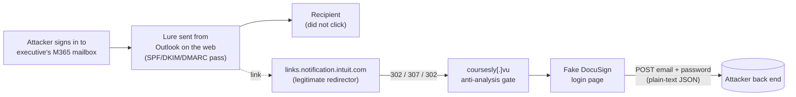

# Phishing Incident Analysis: Compromised Executive Mailbox

| | |
|---|---|
| **Classification** | `TLP:CLEAR` (may be shared freely) |
| **Analyst** | Ahmed Jamalallail |
| **Incident date** | 18 November 2026 |
| **Report date** | 19 November 2026 |
| **Status** | Closed. No compromise at the receiving organisation; takedown requests filed |

## TL;DR

- **What:** a "document shared with you" email from a senior executive's **real, compromised Microsoft 365 mailbox**. It was not spoofed: SPF, DKIM and DMARC all passed.
- **Where it led:** a legitimate Intuit click-tracking redirect, then a **fake DocuSign login** on `coursesly[.]vu` that posts credentials in plain text to the attacker's server.
- **Evasion:** custom gates that detect automation, VMs and sandboxes. They blocked an automated urlscan.io scan, so the kit was analysed manually using fake credentials.
- **Impact:** none at the receiving organisation. One recipient; no click, no credentials entered.
- **Actions:** sender organisation notified; abuse reported to Cloudflare, the hosting provider and Intuit; IOCs published in [CSV](iocs.csv) and [STIX 2.1](iocs.stix.json).

### Attack flow



## 1. Summary

On 18 November 2026 at 15:28 UTC, a staff member at an organisation received an email that appeared to come from a senior executive at another company, saying a document had been shared for review. Analysis showed it was a phishing email sent from the executive's real, compromised Microsoft 365 account, not a spoofed one: SPF, DKIM and DMARC all passed for the sender's domain, and artefacts in the message show it was written in Outlook on the web inside that mailbox. The recipient did not click the link or enter any credentials, so there was no compromise on the receiving side. The link was traced through a legitimate Intuit click-tracking redirect to a fake DocuSign login page that sends credentials in plain text to the attacker's own server; the site was reported to Cloudflare and its hosting provider, and the redirect to Intuit.

## 2. Scope and Method

- **Evidence:** one email file (`.eml`) received by the recipient. On 19 November 2026 at 08:04 UTC it was copied into a case folder, made read-only, and hashed (SHA-256 `b5dcf7a82012161b62e04814bba1f12cd1e3a15a1cf2cc7bbf7d89ea7ef9db8c`). All analysis was done on that copy, and every step was recorded in a timestamped case log.
- **Evidence availability:** the original `.eml` and the HAR network capture are **withheld** from this repository. They contain personal data and identifiers of the people and organisations involved: recipient and sender addresses, server names, a per-campaign tracking token, session cookies, and the analyst's network details. Only their SHA-256 hashes are published, so that copies shared privately (for example with affected parties or authorities, on request) can be checked against this report.
- **Header and body analysis:** Sublime Text (raw view, no rendering), `shasum`, `whois`, `dig`.
- **Scoping:** delivery logs on the receiving mail server, to check whether any other mailbox received the email.
- **Link analysis:**
  - urlscan.io sandbox, to follow the redirect chain without visiting the site.
  - Manual visit in an updated Brave private window over a VPN, with DevTools Network recording (exported as a HAR file, SHA-256 `acea14568cdecfe577e87937cc20a79ed970ee833cdc1d4f058d1e800dc10370`).
  - Only invented credentials were entered: `analyst.test@example.com` (a reserved domain that belongs to no one) and a made-up password.
  - A virtual machine was not used. In hindsight this helped: the site's gate script checks for software-rendered graphics, a common sign of a VM or sandbox, and might have blocked one.
- **Boundaries:** observation only. No real credentials were used, and no attacker endpoint was probed, scanned or reused beyond the normal page flow.

### Limitations

- **Sender's IP address:** not visible. Microsoft removes the client IP from outbound headers; only the sender organisation's Microsoft 365 sign-in logs show where the mailbox was accessed from.
- **Phishing server's IP address:** not found. The site sits behind Cloudflare with a wildcard DNS record and no mail records, and DNS history shows only Cloudflare addresses. Cloudflare named the hosting provider but discloses origin IPs only to law enforcement.
- **Credential storage:** not confirmed. The fake password was submitted after the site's short-lived session pass (about 5–6 minutes) had expired, and the server returned the gate page. It cannot be confirmed whether the server stored the submission.
- **Analysis environment:** the site was opened in a browser on the analyst's own computer (VPN, private window), not on an isolated machine. The risk was reduced by an up-to-date browser and by not downloading or allowing anything.
- **Recipient exposure:** "no click, no credentials entered" is based on the recipient's own statement and was not cross-checked against the mail server's login logs.
- **Final data destination:** what the attacker's server does with captured credentials (for example, forwarding them to a Telegram bot or an email address) happens on the server side and cannot be observed from outside.

## 3. Timeline (UTC)

Times marked `~` are approximate (reconstructed from the case log); all others come from email headers, server responses or tool records.

### Attack

| Time | Event | Source |
|---|---|---|
| 2026-10-09 15:21:22 | Phishing domain registered (registrar: Global Domain Group LLC) | Registrar WHOIS |
| 2026-10-09 | TLS certificate issued for the phishing domain (3-month validity), same day | urlscan.io |
| 2026-11-18 15:19:18 | Email created in Outlook on the web, inside the compromised mailbox | `Date:` header |
| 2026-11-18 15:27:19 | Email submitted and handed between Microsoft 365 servers (~8 min after creation) | `Received:` hops 1–2 |
| 2026-11-18 15:28:05 | Email delivered to the recipient's mailbox | `Received:` hops 3–4 |

### Response

| Time | Event | Source |
|---|---|---|
| 2026-11-19 08:04 | Evidence preserved (read-only copy, SHA-256) | Case log |
| ~08:15–09:23 | Analysis of headers, authentication, spam verdict, body and sender domain | Case log |
| 09:29:55 | Sandbox scan: redirect to the phishing domain confirmed; Google Safe Browsing flags it as malicious | urlscan.io |
| ~09:40 | Phishing site reported to Cloudflare | Cloudflare abuse form |
| ~09:50 | Redirect abuse reported to Intuit | Email |
| ~09:55 | Exposure check: only one mailbox in the organisation received the email | Mail server delivery logs |
| 10:07:31 | Second scan: site still live; scanner now stopped at a fake "Just a moment" gate | urlscan.io |
| 10:11:14 | Manual visit: first request, fake "Human verification" gate shown | HAR |
| 10:12:23 | Gate proof-of-work solved by the browser | HAR |
| 10:13:16 | Fake email address submitted to the fake DocuSign page | HAR |
| 10:17:24 | Session pass expires (issue time not captured; roughly 5–6 min after the gate) | Cookie `exp` field |
| 10:18:38 / 10:18:42 | Fake password submitted twice (`attempt` 1 and 2); server returns the gate page | HAR |
| ~10:33 | Network capture exported as evidence (HAR, SHA-256) | Case log |
| ~10:50 | Cloudflare names the hosting provider; site reported to that provider | Cloudflare reply |
| ~10:57 | Follow-up to Cloudflare: brand is DocuSign; asked to block the whole domain | Email |
| 2026-11-19 (time not recorded) | Sender organisation notified of the compromise and the findings | Receiving organisation's IT |

## 4. Findings

Names and domains of the organisations involved are redacted. The sender organisation's domain appears as `sender-co.example`.

### 4.1 Delivery path

The `Received:` headers (read bottom to top) show four hops, all expected:

| Hop | From → By | Protocol | Time (UTC) | Meaning |
|---|---|---|---|---|
| 1 | Exchange Online mailbox server → itself | MAPI | 15:27:19 | Submitted by a signed-in user of the mailbox (Outlook / Outlook on the web), not relayed from outside. The IP is IPv6 link-local (`fe80::/10`), so it can't be traced. |
| 2 | Mailbox server → Exchange Online transport server | SMTP, TLS 1.2 | 15:27:19 | Internal Microsoft handoff. Both IPs are in `2603:1000::/24` (Microsoft Corporation). |
| 3 | Exchange Online outbound (`52.101.69.133`, Azure West Europe) → receiving mail server | ESMTPS, TLS 1.3 | 15:28:05 | Crossed into the receiving organisation's network. This is the most trustworthy header, because the receiving server wrote it. |
| 4 | Receiving mail server → mailbox store | LMTP | 15:28:05 | Delivered to the recipient's mailbox. |

The `Date:` header (15:19:18) is about 8 minutes earlier than hop 1. This could mean the message waited in an outbound queue, for example while Microsoft throttled a mass send, but that can't be confirmed from one message.

### 4.2 Authentication: compromised account, not spoofing

| Check | Result | Evidence |
|---|---|---|
| SPF | pass | Envelope sender `sender-co.example`; its SPF record allows only Microsoft 365 (`-all`) |
| DKIM | pass | Signature `d=sender-co.example`, `s=selector2` |
| DMARC | pass (`action=none`) | `From:` domain aligned with both SPF and DKIM |
| Receiving server (independent check) | SPF pass; DKIM valid and aligned with the `From:` domain | Spam-filter report on the receiving server |

A spoofed email fails these checks. Passing all of them means the email was genuinely sent through the sender organisation's own Microsoft 365. An internal header that shows `dkim=none (message not signed)` is not a contradiction: Exchange Online stamps it at submission, before it adds the DKIM signature on the way out.

### 4.3 Spam filter verdict

The receiving server's spam filter scored the message well below its spam threshold, so it was not flagged. Valid SPF and DKIM counted in its favour, the Bayesian classifier was undecided, and the only rule that recognised the lure was a test rule worth no points. **A real, compromised account defeats filters that rely on sender reputation.**

### 4.4 Message body

- **Lure:** a fake "A document was shared with you" notification that copies Microsoft's sharing email (its button colour is Microsoft's `rgb(15,108,189)`). It names no file and gives no context, says "Please do not forward this email" to stop the recipient checking with others, and ends with the sender's real signature.
- **Template leftover:** the footer names a person who has nothing to do with the sender. This is a leftover from the phishing kit's template.
- **Composed in Outlook on the web:** the HTML contains 15 Outlook-on-the-web markers (`id="OWA…"`, `OWAAutoLink`, `elementToProof`, the Aptos font). The button's wrapper `div` is nested five times with the same `id`, a sign the template was pasted in. A `data-signature-name` attribute shows that Outlook added the account owner's saved signature by itself.
- **Link:** a single call-to-action link, identical in the text and HTML parts. It points to Intuit's legitimate click-tracking domain (`links.notification.intuit.com/ss/c/…`), which hides the real destination behind a trusted brand.

**Conclusion:** the attacker signed in to the executive's mailbox through Outlook on the web, pasted in a phishing template, and sent it.

### 4.5 Sender verification

- **Domain ownership:** the national domain registry lists the domain under the company's registered legal name, and its DNS is hosted with a long-established regional provider. It is not a lookalike domain. (The registry does not publish creation dates.)
- **Signature check:** the name in the signature matches the executive listed on the company's public website. The job title differs, probably because the website is out of date. Because Outlook inserted the signature automatically, this is not a sign of forgery.
- **Ruled out:** a similarly named, unrelated company with a different founder, location and email security setup. There was no rename or merger. The similarity is a common surname and was not chosen by the attacker.
- **Sender's domain security:** DMARC `p=none` with no reporting address (`rua`), and DNSSEC not enabled (the chain breaks at the customer domain). Neither caused this incident, since a genuine account passes DMARC either way, but both leave the domain easy to spoof.

### 4.6 Link and phishing kit

**Redirect chain:**
```
links.notification.intuit.com/ss/c/[TOKEN]   302
 → http://coursesly.vu/page                   307
 → https://coursesly.vu/page                  302
 → https://coursesly.vu/<random 12-hex path>  (new for each visitor)
```

**Infrastructure:**
- `coursesly.vu` was registered on 2026-10-09 through Global Domain Group LLC. Its TLS certificate (3-month validity) was issued the same day.
- It is behind Cloudflare, with Cloudflare name servers, a wildcard DNS record and no MX records.
- Its back end runs PHP (`X-Powered-By: PHP/8.2.35`).
- Cloudflare identified the hosting provider as a Hong Kong company.
- Google Safe Browsing flags the domain as malicious.

**Anti-analysis gates.** Two separate gate pages were seen before any phishing content appeared:

1. **"HUMAN VERIFICATION / Just a moment" card** with a "Next" button, copying Cloudflare's wording. Passing it involved a proof-of-work exchange (`POST /v9f3e1 cid=…&pow=…` → a `cont` token, then `get-session?cont=…`). This page's own script was not examined.
2. **"Preparing secure session…" spinner page.** It was returned in place of JSON once the session pass had expired. Its script (examined) does the following:
   - detects automation (`navigator.webdriver`, Headless Chrome, Playwright, Puppeteer, Selenium, PhantomJS, missing `navigator.languages`)
   - waits at least 2 seconds, then continues on mouse or touch movement, or on a 2.2-second timer
   - builds a SHA-256 browser fingerprint from canvas, WebGL, platform, language, timezone, CPU, memory and touch support
   - flags software-rendered graphics (`SwiftShader`, `llvmpipe`), which usually means a virtual machine or sandbox
   - posts the results to `…?__pc=1&cid=<32 hex>` with randomised parameter names, then reloads

The session pass is a cookie holding Base64 JSON `{exp, ua, fp, ip}`, which ties it to the visitor's IP address and browser fingerprint. It expired at 10:17:24, roughly 5–6 minutes after the gate. The exact issue time was not captured, because the HAR export does not include `Set-Cookie` headers. Scripts load from `blob:` URLs, identifiers are randomised, and pages carry `noindex,nofollow`.

As a result, urlscan.io's second scan stopped at the gate. The kit is built to defeat automated analysis.

**Credential capture.** The fake page impersonates **DocuSign** ("Verify Your Identity", then "Log In"). At the email step it accepted an invented address on a reserved domain without checking it. Behaviour with a real corporate domain was not tested. Captured data goes to the attacker's own back end:
```
POST https://coursesly.vu/page/
{"email":"…","send":false,"action":1}                                  → {"redirection":null}
{"email":"…","password":"…","attempt":1,"send":true,"action":1}        (plain text)
{"email":"…","password":"…","attempt":2,"send":true,"action":1}
```
The page sends captured credentials straight to the attacker's own back end. **No client-side relay** to DocuSign or Microsoft was observed. A server-side relay (adversary-in-the-middle) **cannot be ruled out**, because the normal response after a password was never seen: the session pass had expired. The `attempt` counter suggests the kit makes victims enter the password more than once. In this test the session pass had expired, so the server answered with the gate page and the visible page showed "An unexpected error occurred".

### 4.7 Exposure at the receiving organisation

- **Recipients:** mail server delivery logs showed one recipient in the organisation.
- **Recipient actions:** the recipient did not click the link, enter credentials or open any file. This rests on the recipient's statement.
- **Analyst access:** the link was opened only by the analyst, over a VPN. The exit IP recorded by the site was confirmed to belong to the VPN's hosting provider, so the organisation's IP address was never exposed.

### 4.8 Verdict

**Phishing from a compromised executive Microsoft 365 account** at a third-party organisation. It was a mass lure sent to the account's contacts, not aimed at the receiving organisation. It led to a DocuSign-themed credential-phishing page protected by purpose-built anti-analysis gates. **There was no compromise at the receiving organisation.**

## 5. MITRE ATT&CK Mapping

| Tactic | Technique | Evidence | Confidence |
|---|---|---|---|
| Resource Development | **T1586.002** Compromise Accounts: Email Accounts | Valid SPF, DKIM and DMARC; MAPI submission; Outlook-on-the-web markers | High |
| Resource Development | **T1583.001** Acquire Infrastructure: Domains | Phishing domain registered about a month before use | High |
| Resource Development | **T1608.005** Stage Capabilities: Link Target | Phishing kit staged on its own domain; trusted redirect link prepared | High |
| Initial Access | **T1566.002** Phishing: Spearphishing Link | "Open document" link in the email | High |
| Reconnaissance | **T1598.003** Phishing for Information: Spearphishing Link | Credentials collected through a fake login page | High |
| Defense Evasion | **T1656** Impersonation | Copies a DocuSign login and a Microsoft sharing notification | High |
| Defense Evasion | **T1497.001** Virtualization/Sandbox Evasion: System Checks | Automation, WebGL software-rendering and interaction checks in the gate | Medium (applied to a web page rather than malware) |
| Defense Evasion | **T1027** Obfuscated Files or Information | `blob:`-loaded scripts, randomised identifiers | Medium |
| Command and Control | **T1665** Hide Infrastructure | Cloudflare proxy, wildcard DNS, gate that blocks scanners | Medium |
| Execution | **T1204.001** User Execution: Malicious Link | Intended outcome; **did not happen** here | n/a |

## 6. Indicators of Compromise

Machine-readable copies for import into security tools:
- [`iocs.csv`](iocs.csv): flat list with type, value, description and suggested action
- [`iocs.stix.json`](iocs.stix.json): STIX 2.1 bundle of 5 indicators (checked with the OASIS `stix2-validator`)

⚠️ Those files contain **live (not defanged) values** so tools can match them. Do not click them. The table below is defanged. Tokens and victim identifiers are removed everywhere.

| Type | Indicator | Note |
|---|---|---|
| Domain | `coursesly[.]vu` | Phishing kit; block the whole domain |
| URL | `hxxps://coursesly[.]vu/page` | Entry point (redirects to a random path) |
| URL | `hxxps://coursesly[.]vu/page/` (POST, JSON) | Where captured credentials are sent |
| URL pattern | `hxxps://coursesly[.]vu/[0-9a-f]{12}` | Per-visitor gate path |
| Redirector | `hxxps://links[.]notification[.]intuit[.]com/ss/c/[TOKEN]` | Legitimate service being abused. **Do not block the domain**; report the link |
| Hosting | SINO WORLDWIDE TRADING LIMITED (HK) | According to Cloudflare |
| Registrar | Global Domain Group LLC | Domain created 2026-10-09 15:21:22 UTC |
| Email subject | `<Name> Has Shared You A Document` | |
| Lure strings | "A document was shared with you" · "Please do not forward this email" | |
| Page titles | "Just a moment" · "Verify Your Identity" · "Log In" (DocuSign branding) | |
| HTTP | `X-Powered-By: PHP/8.2.35` behind Cloudflare | |
| Gate artefacts | `POST …?__pc=1&cid=<32 hex>`; `POST /v9f3e1` with `pow=`; Base64 JSON cookie `{exp,ua,fp,ip}` | The path and parameter names may change between deployments |

Cloudflare IP addresses (`188.114.96.0/20`, `104.21.0.0/16`, `2a06:98c1::/32`) are **not** useful indicators, because many legitimate sites share them.

## 7. Recommendations

**Sender organisation (compromised account):**
1. Reset the password **and revoke all active sessions and tokens**. A password reset alone does not end an active session.
2. Check the mailbox for forwarding and inbox rules, delegated access and OAuth app consents added by the attacker.
3. Review Microsoft 365 sign-in logs to find out how and from where the account was accessed, and review Sent Items to see who else received the lure.
4. Enforce phishing-resistant MFA (security keys or passkeys) for executives.
5. Move DMARC to `p=quarantine`, then `p=reject`, with a `rua` reporting address. Enable DNSSEC.

**Receiving organisation:**
1. Block `coursesly[.]vu` at the DNS or web filter.
2. Brief staff: a genuine sender name and valid security checks do not make an email safe. Unexpected "shared document" emails should be checked with the sender by phone first.
3. Give staff a single, easy way to report suspicious email to IT.
4. Prefer phishing-resistant MFA methods (security keys or passkeys) wherever MFA is used.

**Service providers:**
1. **Cloudflare:** restrict the entire hostname, since paths change per visitor (requested in a follow-up).
2. **Intuit:** disable the tracking link and the account that created it (reported).
3. **Hosting provider:** suspend the hosting account (reported).
4. **Registrar:** suspend the domain.

## 8. Lessons Learned

1. **Passing SPF, DKIM and DMARC proves who sent an email, not that it is safe.** Compromised accounts get past reputation-based filtering.
2. **Similar names are not evidence of a lookalike domain.** An unrelated company with a similar name was briefly suspected. The registry record and the companies' own websites settled it.
3. **Automated sandboxes can be beaten.** The kit's gate stopped urlscan.io, and only careful manual analysis with fake credentials showed what the site does.
4. **Check scan visibility before submitting.** Two scans went out as public by mistake, which published the tokenised link; removal was requested. Use Private scans for links that carry tokens.
5. **Keep the case log as you go.** Several entries had to be reconstructed afterwards and marked as approximate. Time zones (local time vs UTC) also caused an early misreading.
6. **Check what people tell you.** An early note that the recipient clicked the link was a misunderstanding (the analyst had opened it) and was corrected in the log.
7. **Use a clean analysis browser.** A password-manager extension was active during the manual analysis. It wasn't used, but it was an avoidable risk.
